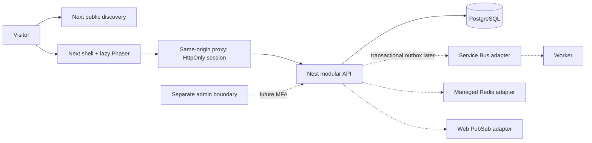

# Architecture

## Modular monolith

Next.js marketing is separate from the Next.js game shell, which lazy loads Phaser. NestJS owns authoritative state; the browser renders and sends intents. A separate worker process executes background work via an adapter. Admin is a separate app with no privileged API implemented yet. No microservice proliferation.

Package ownership: domain (pure player contracts/validation); campus-content (catalogue and fixtures); game-engine (render/movement primitives); database (Prisma repository); auth (guest capability/authentication ports); security (request protections); config (environment); observability (redacted request logs); payments (disabled provider port); UI (tokens/components); testing (fixtures). Packages export typed entry points; do not reach into another package's internals.

Identity, Catalogue, Simulation, Academics, Economy, Social, Commerce, Payments, Advertising, Content Intelligence, Moderation, Notifications, Analytics are bounded contexts. API orchestrates domain/repositories, not vice versa. Financial operations never share virtual currency tables. Publish versioned domain events through a transactional outbox when workers are added; consumers use inbox uniqueness, retries, exponential backoff and DLQ. Presence is ephemeral; it cannot change durable state.

Local memory is a demo adapter, bounded to 1,000 active guests and 24-hour TTL. PostgreSQL is the persistent adapter. Tokens are random bearer capabilities, stored only as keyed hashes at rest and delivered via same-origin HttpOnly cookies. Guests are not verified identities. Entra adapter remains a port; no pretend OAuth login.

Extraction triggers: independently hot workloads, compliance isolation or distinct deployment ownership, measured first. Public staging requires shared atomic rate/replay counters and validated private ingress, even with one API replica. Build-time Next public environment values must match deployment origin. See ADRs before changing these decisions.

## Phase 0.5 boundaries

The BFF is a service boundary, not an IP-transparent proxy. [ADR 005](decisions/005-bff-trust-and-abuse.md) defines a server-signed anonymous cookie, authenticated ingress assertion and signed API context. Per-client limits are separate from broader network limits; arbitrary forwarded headers are ignored. Nonlocal internal API emits no browser CORS allowance. Private networking remains necessary in addition to signatures. Shared atomic counters/replay storage and the Azure ingress bridge remain deployment gates; nonlocal guest traffic fails closed without bridge proof.

The worker now executes bounded guest cleanup ([ADR 007](decisions/007-bounded-guest-retention.md)); queue-driven product jobs remain absent. Catalogue contracts are typed versioned fixtures with entity-level provenance and explicit programme stages ([ADR 006](decisions/006-explicit-academics-and-content.md)). No new product systems or extracted services are activated.
