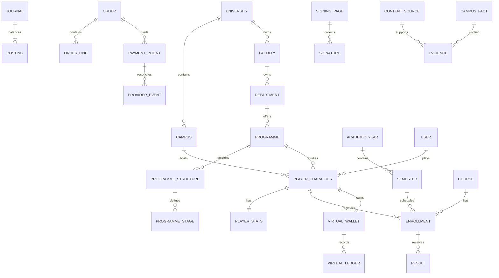

# Domain model and schema proposal

## Ownership and aggregates

| Context              | Aggregate roots and owned records                                                                                               |
| -------------------- | ------------------------------------------------------------------------------------------------------------------------------- |
| Identity             | User, Profile, Session, role grants, Payout eligibility references                                                              |
| Campus Catalogue     | University → Campus; Faculty → Department → Programme → ProgrammeLevel; Location, Building, Venue, Route, TransportMode, Hostel |
| Simulation           | PlayerCharacter → PlayerStats, Inventory/Item ownership, Skill, Room/Roommate, WahalaEvent; WahalaTemplate                      |
| Academics            | AcademicSession → Semester; Course, Enrollment → Assessment (Lecture/Assignment/Test/Exam), Result; Progression                 |
| Economy              | VirtualWallet → immutable VirtualLedger; Hustle, simulated Job, virtual Business                                                |
| Social               | Friendship, Club, Organization, CampusEvent, Quest, Achievement, CampusWar/Leaderboard                                          |
| Commerce             | VerifiedBusiness → Product; Order → OrderLine/StateHistory; real Job                                                            |
| Payments             | PaymentIntent, ProviderEvent, Journal → Posting, PayoutProfile, Gift, FeePolicy                                                 |
| Memories             | SigningPage → Signature, MemoryBook, BirthdayEvent, CreatorProfile, Fundraiser                                                  |
| Advertising          | Advertiser → Campaign → Creative, Placement, Impression, Click                                                                  |
| Content Intelligence | ContentSource → CampusFact → Evidence, FactFeedback                                                                             |
| Moderation           | Report, ModerationEvent, AuditLog                                                                                               |

This is a proposal, not a claim that these tables exist. Phase 0 migration only adds GuestPlayer: UUID, campus/programme keys, current level, individual duration, avatar/preset nickname, hashed capability, expiry and timestamps. Catalogue stays versioned fixture configuration until validated research supports normalized import. Guest has no user foreign key and no publicly queryable list. Phase 1 adds identities, versioned structure/stage catalogue and explicit guest-to-player conversion, transactionally.

IDs are opaque UUIDs; tenant/campus filters do not replace resource ownership. Money uses integer minor units / database BigInt, never floats. Every amount carries a currency/domain; virtual cash cannot enter real postings. Financial posting sums must be zero per currency, enforced transactionally and by database constraints/triggers. Settled journals append only; reversals reference the original journal. Provider references and idempotency scope/key are unique. Outbox shares the source transaction.

Indexes: token hash unique, guest expiry/id, campus/programme/level; later enrollment(player, semester), order(merchant,status,created), event(aggregate,sequence), payment(provider,reference), ledger(account,created). Page all lists with bounded cursors. The PostgreSQL worker now purges expired guests at startup/every 15 minutes in bounded batches; access expiry remains enforced on reads. Deployment cadence/backlog alerts remain release gates. Audit/financial retention requires legal policy.

## Explicit academic position

Programme → versioned ProgrammeStructure → ProgrammeStage → explicit semester definitions. AcademicYear is a separate calendar record. `AcademicPosition` declares structure ID/version, stage ID, academic year/semester, admission mode, enrollment state and attempt. These are Phase 1 contracts, not added tables or a progression engine.

Guests retain numeric `level` as a compatibility code (1..9999), selected from the registered programme's explicit stages. It need not be a multiple of 100. Personal durationYears (1..12) never validates or generates stages. Direct entry/transfers need future admission checks; repeated stages retain stage identity with a new attempt/history. Interruption/deferment changes enrollment state. SIWES/IT associates authored tags/templates with stage IDs. No universal internship year or numeric next-level formula.

Migration 202610090002_explicit_stages removes both arithmetic CHECK constraints, adds independent bounds and an expiry/id index without rewriting guests. PlayerService enforces catalogue membership; configuration is not yet relational. The PostgreSQL regression test persists stage 42 with a one-year preference to prove arithmetic is gone. Phase 1 normalized imports must pin structure versions and add transactional catalogue FKs.
