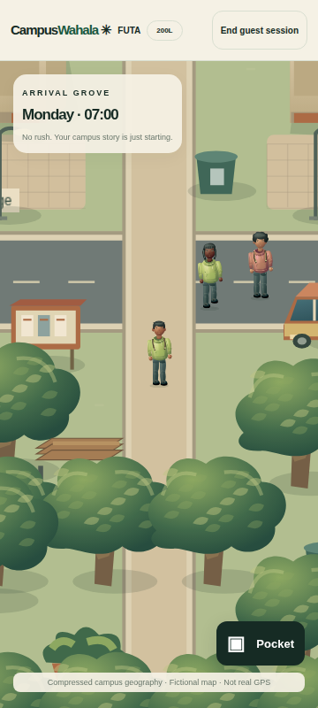
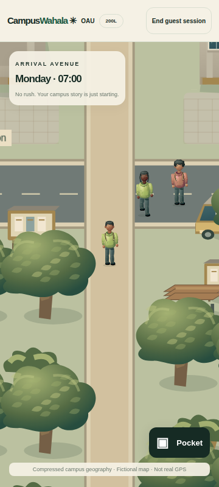
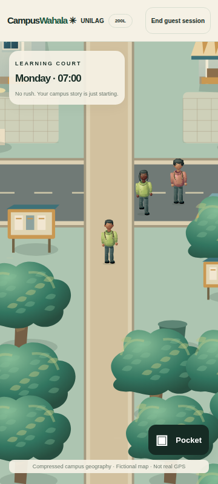
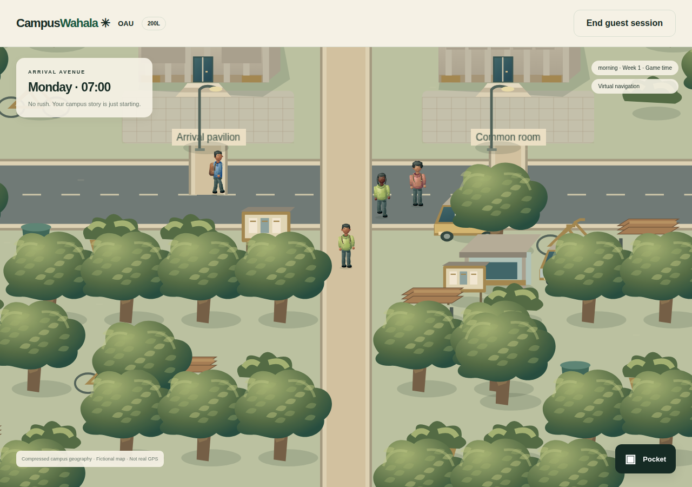
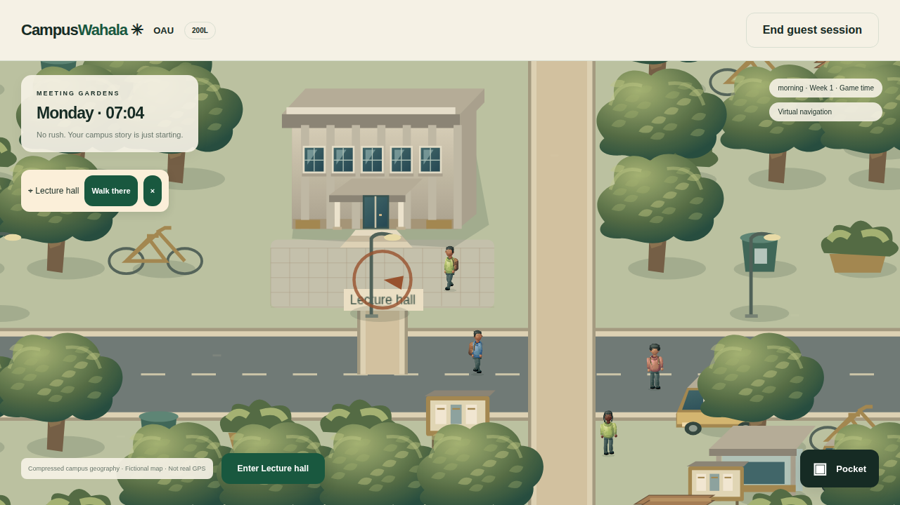
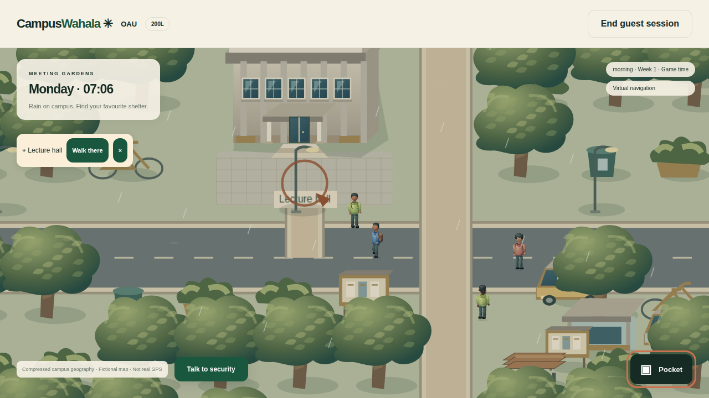
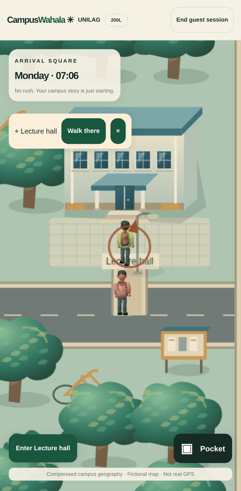

# M3 production visual review board

**M3 visual approval pending.** Prepared for [reviewer 6172854232](https://github.com/kinglove58/campuswahala/pull/17#issuecomment-6172854232). PR #17 stays draft, open and unmerged. M4–M6 and Phase 5 remain unstarted.

Every image and video below is an **unedited, byte-identical ZIP entry** from [successful push run 38539501832](https://github.com/kinglove58/campuswahala/actions/runs/38539501832), production commit **`0bfb7109ea227feb7b60c66ed554f04337fab13b`**, [artifact 11883262093: m3-production-exterior-proof](https://github.com/kinglove58/campuswahala/actions/runs/38539501832/artifacts/11883262093). No screenshot was fabricated, redrawn, resized, cropped, annotated or recompressed. Click an image to open its original PNG; the viewer may fit large images to its window, but stored pixels and dimensions are unchanged. [Per-file byte counts, SHA-256 and exact source entries](m3-visual-review/provenance.json) verify provenance, including the GitHub-reported archive digest.

The three native stills are exactly **360×800** (DPR1). They show the production guest player/shared-rig NPCs at the approved close camera. Supplemental venue and desktop images retain their original dimensions. These are software-browser captures, **not physical Android tests**. Rain is a cosmetic preview, not authoritative weather. Captures establish review material; they do not grant visual approval.

## Native campus comparisons and matching walking videos

### FUTA — native 360×800

Pitched terracotta roofs, warmer paving and dense green groves. Source: run **38539501832**, commit **`0bfb7109ea227feb7b60c66ed554f04337fab13b`**, ZIP entry **`futa-360x800-dpr1.png`**.

[Play/open matching FUTA actual walking video — original 360×800](m3-visual-review/futa-walking-360x800.webm?raw=true). Same run/commit; ZIP entry **`futa-walking-360x800.webm`**. The video starts at this production spawn and shows actual keyboard walking/camera follow.

### OAU — native 360×800

Restrained concrete/terrace palette, shaded institutional bays and readable routes. The supplementary approach below exposes the facade clearly. Source: run **38539501832**, commit **`0bfb7109ea227feb7b60c66ed554f04337fab13b`**, ZIP entry **`oau-360x800-dpr1.png`**.

[Play/open matching OAU actual walking video — original 360×800](m3-visual-review/oau-walking-360x800.webm?raw=true). Same run/commit; ZIP entry **`oau-walking-360x800.webm`**. The video starts at this production spawn and shows actual keyboard walking/camera follow.

### UNILAG — native 360×800

Cooler blue-green/canopy treatment. The supplementary production venue approach below shows the real Lecture hall prompt. Source: run **38539501832**, commit **`0bfb7109ea227feb7b60c66ed554f04337fab13b`**, ZIP entry **`unilag-360x800-dpr1.png`**.

[Play/open matching UNILAG actual walking video — original 360×800](m3-visual-review/unilag-walking-360x800.webm?raw=true). Same run/commit; ZIP entry **`unilag-walking-360x800.webm`**. The video starts at this production spawn and shows actual keyboard walking/camera follow.

## OAU desktop overview — original 1280×900

Source: run **38539501832**, commit **`0bfb7109ea227feb7b60c66ed554f04337fab13b`**, ZIP entry **`oau-1280x900-dpr1.png`**.

## OAU clear-weather venue approach — original 1280×720

Source: run **38539501832**, commit **`0bfb7109ea227feb7b60c66ed554f04337fab13b`**, ZIP entry **`oau-lecture-desktop.png`**.

## OAU cosmetic rain preview — original 1280×720

Source: run **38539501832**, commit **`0bfb7109ea227feb7b60c66ed554f04337fab13b`**, ZIP entry **`oau-rain-desktop.png`**.

## UNILAG genuine venue approach (original higher-resolution capture) — original 1082×2202

Source: run **38539501832**, commit **`0bfb7109ea227feb7b60c66ed554f04337fab13b`**, ZIP entry **`unilag-lecture-mobile.png`**.

The clear/rain OAU pair comes from the same genuine venue journey. UNILAG's venue capture is **1082×2202**, preserved exactly; it is supplementary evidence and is not relabelled as native 360×800.

## Technical and human review boundaries

This evidence-only board changes no production code, character art, movement, camera, campus geometry, saved Appearance, authority, private cache controls or gameplay tests. Production CI at the identified capture commit passed all five jobs on both push and PR merge checkout: 182 unit/database and 66 browser passes, with ten disclosed duplicate evidence skips. See [the full M3 report](phase-4.2-m3-review.md) and PR body for performance, compatibility and failed-iteration disclosures. A board-only commit does not change the source commit of these captures.

Three existing high CodeQL findings remain open for separate remediation before final Phase 4.2 approval: [#1](https://github.com/kinglove58/campuswahala/security/code-scanning/1), [#2](https://github.com/kinglove58/campuswahala/security/code-scanning/2), [#3](https://github.com/kinglove58/campuswahala/security/code-scanning/3). Physical low/mid-range Android touch, frame rate, memory, thermal and long-session testing remains unperformed. **Stop for M3 visual review.**
